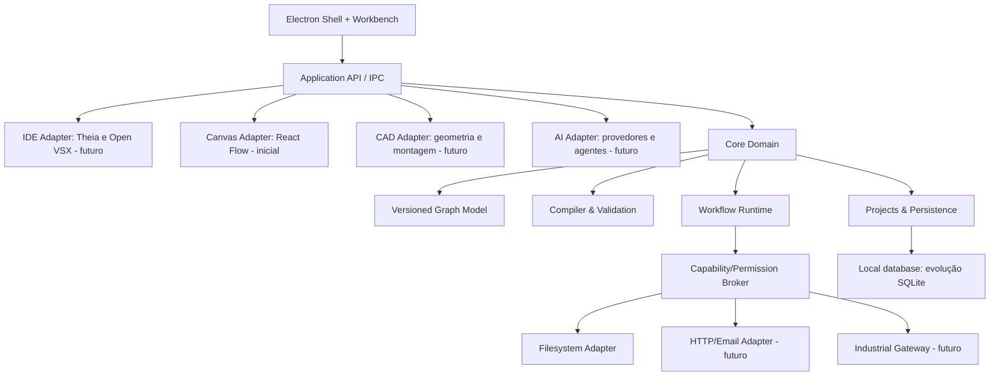

# Especificação de arquitetura — OmniForge Studio

Documento técnico inicial · 2026-10-28 · v0.1.0

## 1. Missão e delimitação

Construir um ambiente local de desenvolvimento e engenharia onde modelos de arquitetura, fluxos executáveis e modelos físicos podem se relacionar por vínculos versionados. Usar uma aplicação Electron e plugins/serviços isolados. Ser capaz de integrar IDE, automações, IA, CAD e dispositivos industriais com **contratos explícitos**, não com acessos irrestritos a um objeto global ou à UI.

Não será uma cópia de VS Code, n8n ou AutoCAD. Cada componente deve cumprir uma função comprovada por testes. Componentes complexos com licenças restritivas não serão incorporados sem análise jurídica.

## 2. Separação de domínios

### 2.1 Grafo de arquitetura (design-time)

Nós: serviço, repositório, componente, API, banco, fila, modelo, circuito, PLC, unidade física, módulo CAD.

Arestas: dependência, chamada, evento, referência, topologia ou associação semântica. Propriedades: owner, versão, contrato API, protocolo, latência estimada, classificação de risco, testes associados.

Métricas: ciclos em dependências que exigem DAG, contratos incompatíveis, SPOF, acoplamento, fronteiras de confiança, alteração de interface sem migração. Nenhuma métrica, sozinha, comprova que a aplicação não quebrará.

### 2.2 Grafo de execução (runtime)

Nós: gatilho, transformação, integração, condição, fila, aprovação, efeito, recuperação. Portas com tipos e semântica. Arestas carregam dados e/ou eventos com rastreabilidade. Fluxo versionado e determinístico. Retentativas, idempotência e compensação serão incorporadas antes de ações externas que possam ser repetidas.

O MVP v0.1 é DAG determinístico. Não há laços, concorrência, retries, timers, filas ou eventos automáticos ainda. Cada execução é explicitamente iniciada pelo usuário.

### 2.3 Grafo de engenharia/controle físico (industrial)

Nós: sensor analógico/digital, atuador, gateway, PLC, conversor, rede, controlador de movimento, modelo mecânico. Arestas tipadas com unidade, direção, taxa de atualização, nível de segurança, compatibilidade elétrica e protocolo. **Grafo físico não é interpretado como automação de TI automaticamente**. A interface deve deixar explícito quando uma operação pode afetar máquinas reais.

## 3. Camadas de referência



## 4. Contratos e invariantes

- O manifesto de cada tipo de nó declara `type`, `category`, `inputs`, `outputs` e `fields`.
- Nós executáveis possuem um `type` conhecido, `id` único, configuração validável, e versão de contrato.
- Portas de tipos incompatíveis não são executadas.
- O grafo tem ordenação topológica; ciclos são rejeitados no MVP.
- Entradas obrigatórias devem estar conectadas e cada uma recebe no máximo uma aresta.
- Não há nós órfãos executáveis: todos devem ser alcançáveis pelo gatilho.
- O engine recebe o grafo serializado, nunca componentes React.
- A execução ocorre no processo privilegiado apenas para operações declarativas nativas. Futuro código fornecido pelo usuário **não** deve ser avaliado neste processo.
- A vista 3D não será fonte de verdade do CAD: dados paramétricos, unidades e restrições estruturais serão persistidos em modelo separado.
- Segredos nunca entram em JSON compartilhado, mensagens de erro, screenshots ou logs.

### Schema inicial v1

```json
{
  "schemaVersion": 1,
  "name": "Venda - fluxo inicial",
  "nodes": [
    {"id":"inicio","type":"trigger.manual","position":{"x":70,"y":150},"config":{"payload":"{\"venda\":{\"total\":299.9}}"}},
    {"id":"campo","type":"logic.pick","position":{"x":360,"y":150},"config":{"path":"venda"}},
    {"id":"arquivo","type":"io.writeJson","position":{"x":650,"y":150},"config":{"fileName":"venda.json"}}
  ],
  "edges": [
    {"id":"e1","source":"inicio","target":"campo","sourceHandle":"out","targetHandle":"in"},
    {"id":"e2","source":"campo","target":"arquivo","sourceHandle":"out","targetHandle":"in"}
  ]
}
```

## 5. Evolução da IDE

**Escolha estrutural:** Theia é candidato principal para o host de extensões, debugging, terminals, git, tasks, LSP e DAP. Open VSX é o candidato de catálogo permitido. Monaco, usado inicialmente, funciona como editor embutido e **não oferece o host de extensões VS Code**. A introdução de Theia será um módulo com fronteira clara, depois do gate de estabilidade do core. O contrato entre workbench e projeto não pode depender de APIs internas do editor temporário.

- `IDEAdapter.openFile(workspaceId, relativePath)`
- `IDEAdapter.openProject(workspaceId)`
- `IDEAdapter.getDiagnostics()`
- `IDEAdapter.getSymbols()`
- `IDEAdapter.runTestPlan(testPlanId)`

No futuro, depuradores e language servers rodarão em processos adequados, com políticas de permissões específicas. A compatibilidade de cada extensão deverá ser testada, e extensões não confiáveis serão tratadas como código potencialmente perigoso.

## 6. Motor de automação e catálogo

O catálogo é um **registro de contratos**, não uma coleção de botões decorativos. Cada definição deve incluir:

- Identidade estável e `semver`, portas de entrada/saída e esquema de configuração.
- Metadados para a UI, descrição e testes de regressão.
- Declaração de capacidades (filesystem, rede, dispositivo, segredos, comandos), risco e permissões.
- Política de timeout, reexecução/idempotência e geração de logs.
- Executor isolável, com telemetria sem dados sigilosos.

Categorias planejadas (não implementadas): lógica/condições, matemática, tempo, cron, texto, arquivos, SQL, HTTP, webhooks, SMTP, filas, Git, GitHub, CI/CD, REST/GraphQL, IA, embedding/vector DB, LLM tools, comunicação serial, Modbus, MQTT, OPC UA, GPIO, sensores, atuadores, CAD, cinemática, simulação, exportação de modelo, segurança, criptografia, aprovações e notificações.

**Critério de entrada no catálogo:** existir executor real, validação de parâmetros, teste do contrato, documentação e política de risco. A quantidade de nós não é métrica de qualidade.

## 7. Multi-repositório e integrações de projetos

Um workspace representa um diretório local. Uma `ProjectManifest` futura identificará múltiplos repositórios referenciados, APIs expostas, contratos OpenAPI/protobuf, executores instalados e ambientes. Um bloco de projeto externo **não carregará o código inteiro para dentro do Electron**; executará chamada controlada a API local, processo isolado ou serviço remoto, com contrato versionado. Alterações em um projeto não deverão tocar os demais sem autorização explícita.

Exemplo de integração desejada:

`evento de venda` → `validar pagamento` → `solicitar IA para gerar conteúdo` → `aprovar envio` → `serviço de e-mail` → `registrar resultado`.

Para operação real: o gatilho e o provedor de e-mail precisam ser configurados; a chave da IA deve ser tratada como segredo; cada envio precisa de idempotency key e registro de entrega. Simular não equivale a enviar e-mail.

## 8. Modo industrial e requisitos não negociáveis

Camadas previstas: monitoramento read-only → simulação/digital twin → integração laboratório → atuação limitada com aprovação → operação com segurança funcional verificada por especialistas. Nunca acionar equipamento físico apenas porque uma IA sugeriu um bloco. Protocolos industriais são específicos e podem exigir licenças, autenticação por certificados, gestão de rede e segregação operacional.

Limites: a aplicação não será considerada sistema de segurança de máquina, controlador certificado ou alternativa a intertravamentos físicos. A segurança de pessoas e equipamentos não pode depender de um renderer Electron ou de um agente LLM.

## 9. CAD/robotização

Pipeline proposto: pedido em linguagem natural → `DesignSpec` estruturada com unidades → geometrias paramétricas → checks dimensionais e colisões → renderização via Three.js → projeto CAD por kernel (ex.: Open CASCADE via serviço local específico) → exportação STEP/STL conforme capacidade → validação em software de engenharia. Um modelo 3D visual não implica que um robô funcione, suporte carga ou possa ser fabricado. Exige análise cinemática, dinâmica, materiais, eletrônica e tolerâncias.

## 10. Persistência e migrações

v0.1 utiliza `JSON` salvo em `.omniforge/flows/principal.json`; saídas reais em `.omniforge/output/`. v0.2+ deverá introduzir SQLite para auditoria, catálogo instalado, relações entre projetos, revisão de fluxo e histórico de execuções, com esquema versionado e migrações reversíveis sempre que factível. Fluxos devem permanecer exportáveis em formato textual portável.

Proteção contra perda: atualizações nunca apagam os dados de usuário. Antes de uma migração, validar schema atual e oferecer cópia de recuperação fora da raiz do aplicativo. Integridade: checksum, backups transacionais e testes de upgrade/downgrade.

## 11. Processos, filas e isolamento

O renderer não recebe acesso a Node nem a diretórios arbitrários. O broker de capacidades escolhe o executor. Plugins executáveis potencialmente perigosos devem rodar em processo ou container restrito com limites de CPU, memória, rede, filesystem e tempo. `node:vm` não é barreira de segurança. Toda execução deve ser associada a request ID, fluxo, versão, workspace e sujeito/permissão.

## 12. Atualizações, releases e qualidade

- `develop`: mudanças integradas sob testes.
- `main`: última versão aprovada, protegida.
- `vMAJOR.MINOR.PATCH`: versão assinada/tagueada depois de testes e gate manual.
- Pipeline: lint/typecheck → unitários → contrato → integração → smoke Electron → build Windows → instalar/desinstalar/reinstalar → validação de dados persistidos → antivírus/assinatura → release.
- Gates por funcionalidade: `RED` (requisito falha) → implementação → `GREEN` → regressão → evidência → release.
- Falhas no build de UI não são aceitas como PASS. A ausência de ambiente Windows nesta sessão significa que o gate de desktop/instalador não foi completado.
